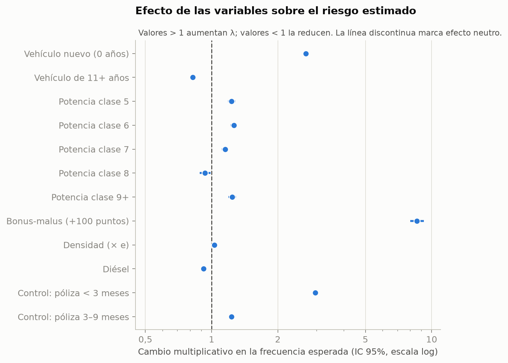
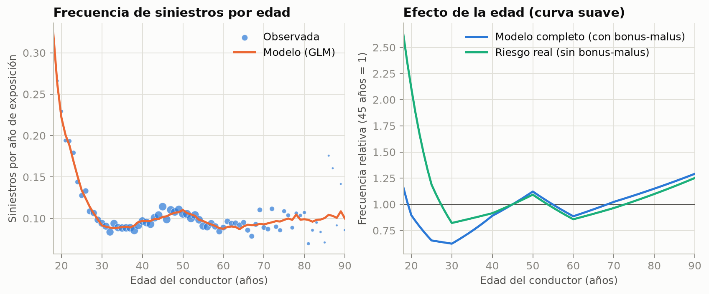
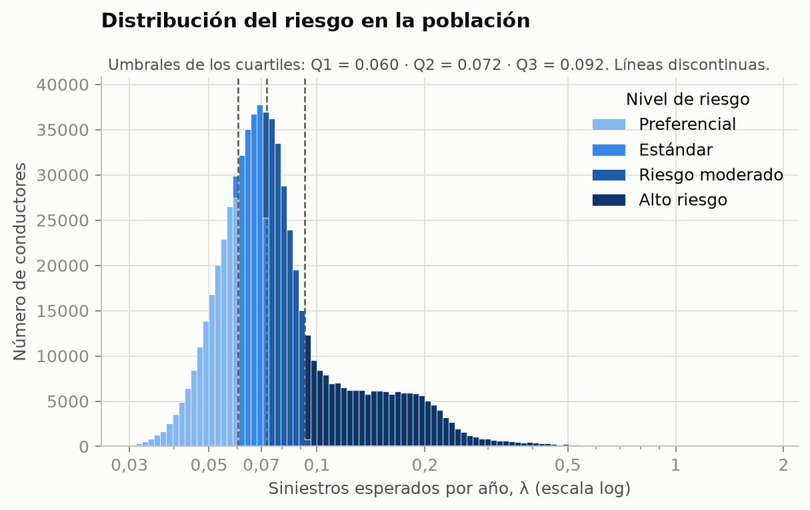
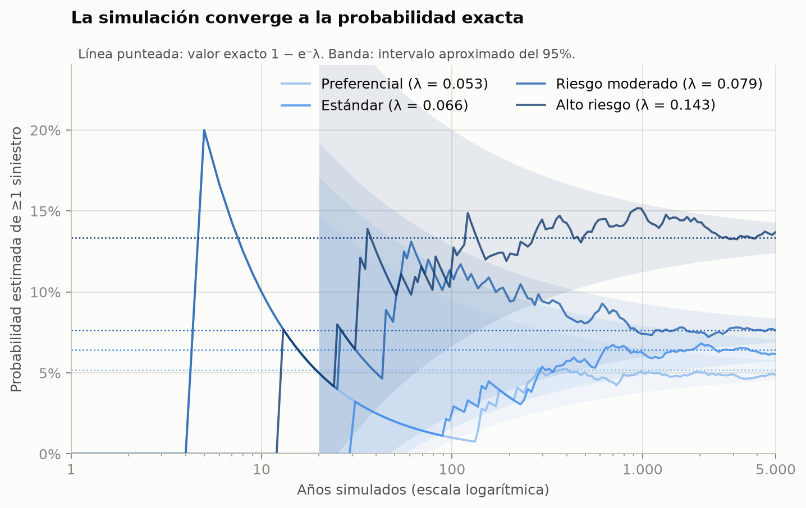
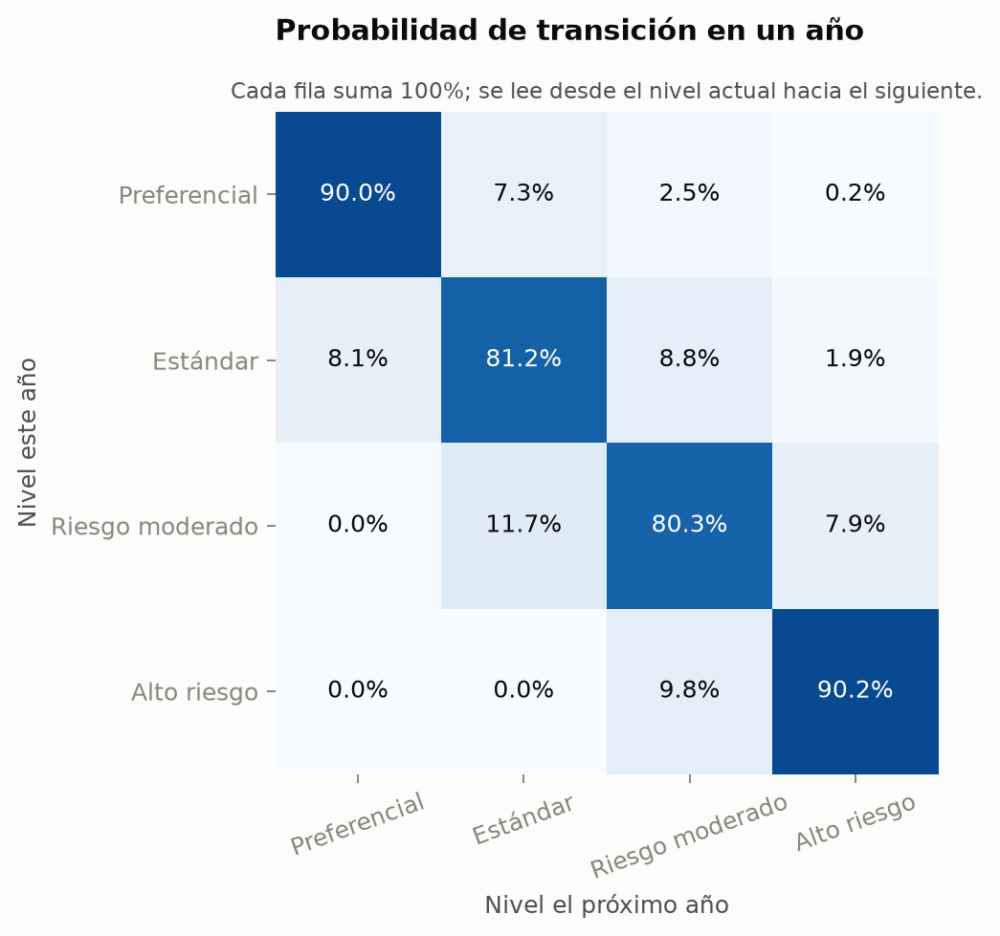
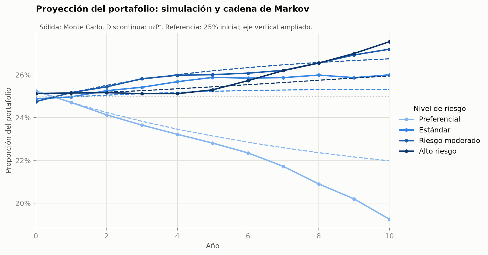
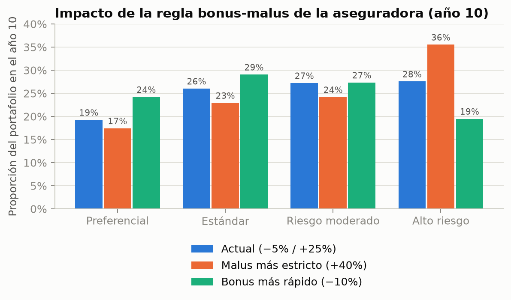
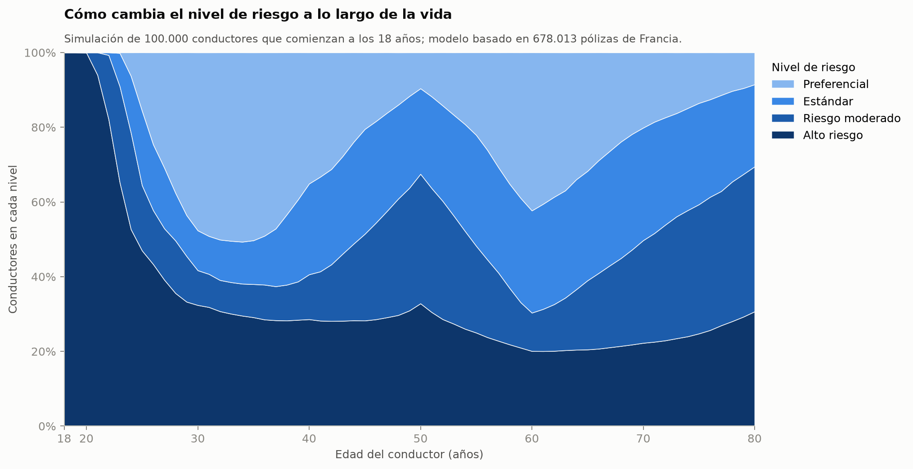

# Avance 1: primer acercamiento

> **Nota:** las figuras de `results/figures/` se regeneran con el modelo actual, así que ya corresponden al [Avance 2](AVANCE_2.md). Las tablas de este documento son las del primer acercamiento.

**Proyecto:** Modelado del riesgo de conductores asegurados y sus transiciones entre categorías
**Materia:** Modelado y Simulación
**Fecha:** 16 de octubre de 2026
**Lenguaje:** C puro (C11, solo biblioteca estándar) para todos los cálculos; Python (matplotlib) solo para las gráficas

## 1. Resumen

En este primer acercamiento se implementó el pipeline completo de punta a punta. Todos los cálculos están en C; el programa escribe sus resultados en tablas CSV, y un script de Python (`plots/plot_results.py`) genera las gráficas a partir de esas tablas:

1. Se eligió una **función de riesgo de la literatura**: un modelo Poisson para la frecuencia de siniestros.
2. Se ajustó con una **población real** de 678,013 pólizas de seguro de auto.
3. Se calculó el riesgo de cada conductor y se le asignó uno de **4 niveles**.
4. Se usó **Monte Carlo** para estimar el riesgo individual y para simular el portafolio durante 10 años.
5. Con la simulación se construyó una **cadena de Markov** y se comparó contra la proyección exacta `π₀·Pᵗ`.
6. Se creó un programa para que **cualquier persona, con sus propios datos**, obtenga su nivel de riesgo.
7. Se siguió a conductores nuevos **de los 18 a los 80 años** para obtener la probabilidad de estar en cada nivel a cada edad (sección 4.7).

Los parámetros, umbrales y escenarios son de una primera versión y se van a refinar en los siguientes avances.

### Qué es dato real y qué es simulación

| | Origen | Qué contiene |
|---|---|---|
| **Datos** | **Reales.** 678,013 pólizas de una aseguradora francesa (freMTPL2freq), publicadas para investigación. No se inventa ni se modifica ningún registro; solo se limpian valores extremos (sección 3). | Edad, auto, zona, historial (bonus-malus) y **siniestros observados** de cada póliza |
| **Modelo** | **Estimado de los datos reales.** Los coeficientes salen de ajustar el GLM a las pólizas (sección 2). | Cuántos siniestros por año espera tener cada tipo de conductor (λ) |
| **Simulación** | **Monte Carlo con el modelo.** Genera futuros posibles, por ejemplo qué le pasa a un conductor de los 18 a los 80 años. | Siniestros, historial y nivel de riesgo **proyectados** año por año |

La simulación es necesaria porque ningún dataset sigue a una misma persona durante décadas: freMTPL2freq observa cada póliza durante un año como máximo. El modelo aprende de los datos reales cómo depende el riesgo de la edad y del historial, y Monte Carlo usa eso para proyectar trayectorias completas. Todas las simulaciones parten de perfiles reales del dataset.

Para este avance también se revisó un dataset alternativo (`data_synthetic.csv`, 53,503 clientes) y se descartó. Es sintético: su nivel de riesgo no tiene relación con la edad, el historial ni el récord de manejo (V de Cramér < 0.05 en todos los casos), y sus IDs repetidos no corresponden a la misma persona. Un modelo con esos datos no puede aprender nada sobre el riesgo.

## 2. Función de riesgo

Se tomó el modelo de frecuencia de **Noll, Salzmann y Wüthrich (2018)**, *"Case Study: French Motor Third-Party Liability Claims"* (SSRN 3164764). Es un modelo lineal generalizado (GLM) de Poisson, el estándar en tarificación de seguros de auto:

$$N \sim \text{Poisson}(e \cdot \lambda(x)), \qquad \log \lambda(x) = \beta_0 + x^\top \beta$$

- `N`: número de siniestros de la póliza.
- `e`: exposición, es decir, los años que estuvo vigente la póliza.
- `λ(x)`: **número esperado de siniestros por año** para un conductor con características `x`. Esta es la medida de riesgo.

Las variables se simplificaron respecto al paper para que una persona pueda reportarlas fácilmente:

| Variable | Tratamiento |
|---|---|
| Edad del conductor | 7 rangos (18–20, 21–25, 26–30, 31–40, **41–50 base**, 51–70, 71+) |
| Antigüedad del vehículo | nuevo (0 años), 1–10 (base), 11+ |
| Potencia del vehículo | clases 4–9 (9 incluye 9 o más) |
| Bonus-malus | coeficiente ×100, de 50 (mejor) a 150; resume el **historial de siniestros** |
| Densidad de población | logaritmo de habitantes/km² |
| Combustible | diésel / gasolina |

### Cómo se estima (implementado en C)

Los coeficientes β se estiman por **máxima verosimilitud** con el **método de Newton** (IRLS), en `src/model.c`. En cada iteración:

1. Se recorre la población y se acumulan el gradiente `g = Σ (yᵢ − μᵢ) xᵢ` y la matriz hessiana `H = Σ μᵢ xᵢ xᵢᵀ`, con `μᵢ = eᵢ·exp(xᵢᵀβ)`.
2. Se resuelve `H·Δβ = g` por **factorización de Cholesky** (`src/linalg.c`) y se actualiza `β ← β + Δβ`.
3. Se repite hasta que `max|Δβ| < 10⁻⁸`. Converge en pocas iteraciones.

Los errores estándar salen de la diagonal de `H⁻¹`. Con 17 parámetros y 610 mil pólizas, el ajuste tarda menos de un segundo.



Cada punto es el efecto multiplicativo `e^β` sobre λ, con su intervalo de confianza del 95%. Un valor de 1 significa que la variable no tiene efecto.

## 3. Población real de conductores

Se usó **freMTPL2freq** (CASdatasets, disponible en OpenML con licencia CC0), el mismo dataset del paper. Tiene **678,013 pólizas** de responsabilidad civil de auto en Francia. El programa en C lee directamente el archivo de texto ARFF (`src/data.c`). La frecuencia observada es de **0.1006 siniestros por año de exposición**.

Siguiendo al paper, se limpiaron los valores extremos: siniestros ≤ 4, exposición ≤ 1 año, antigüedad del vehículo ≤ 20, potencia ≤ 9 y bonus-malus ≤ 150.

## 4. Resultados

### 4.1 Ajuste del modelo

Se ajustó con 90% de los datos (610,234 pólizas) y se evaluó con el 10% restante (67,779):

| Métrica (conjunto de prueba) | Valor |
|---|---|
| Devianza Poisson, modelo nulo (frecuencia constante) | 0.3301 |
| Devianza Poisson, GLM | 0.3134 |
| Reducción | **5.1%** |

Una reducción pequeña es normal en modelos de frecuencia de siniestros, porque la mayoría de las pólizas tiene 0 siniestros y gran parte de la variación es azar. El modelo reproduce bien la frecuencia observada por edad:



Efectos principales (multiplicativos sobre λ, en `results/model_coefficients.csv`):

- **Bonus-malus**: es la variable más fuerte. Pasar de 50 a 100 multiplica el riesgo por ≈ 3.2. El historial de siniestros predice los siniestros futuros.
- **Conductores de 26–40 años**: entre 26% y 35% menos riesgo que el grupo de 41–50, a igual bonus-malus.
- **Vehículo nuevo**: ×3.3. Este efecto es sospechoso; ver la sección 6.

### 4.2 Los 4 niveles de riesgo

Los umbrales son los **cuartiles de λ** en la población, así que cada nivel tiene el 25% de los conductores:

| Nivel | Rango de λ (siniestros/año) | λ medio |
|---|---|---|
| Preferencial | < 0.0707 | 0.061 |
| Estándar | 0.0707 – 0.0853 | 0.078 |
| Riesgo moderado | 0.0853 – 0.1140 | 0.096 |
| Alto riesgo | > 0.1140 | 0.221 |



El nivel "Alto riesgo" abarca una cola larga: hay conductores con λ mayor a 1 siniestro por año.

### 4.3 Monte Carlo: puntaje de riesgo individual

Para cada conductor se simulan *N* años de manejo con siniestros ~ Poisson(λ). El puntaje es la proporción de años con al menos un siniestro.

Los números aleatorios vienen de un generador **xoshiro256\*\*** implementado en `src/rng.c`. Los valores Poisson se generan con el **método de Knuth**: se multiplican uniformes hasta que el producto queda por debajo de `e^(−λ)`.

Como existe la solución exacta `1 − e^(−λ)`, sirve para **validar** la simulación. El error disminuye como `1/√N`; con 5,000 años el error estándar es de ≈ 0.004:



| Conductor típico (mediana del nivel) | λ | P(≥1 siniestro), Monte Carlo | Exacta |
|---|---|---|---|
| Preferencial | 0.063 | 0.058 ± 0.003 | 0.061 |
| Estándar | 0.078 | 0.075 ± 0.004 | 0.075 |
| Riesgo moderado | 0.094 | 0.086 ± 0.004 | 0.090 |
| Alto riesgo | 0.191 | 0.173 ± 0.005 | 0.174 |

### 4.4 Transiciones: simulación del portafolio y cadena de Markov

Se simuló un portafolio de **100,000 conductores durante 10 años**. Cada año:

1. Se simulan los siniestros de cada conductor con Poisson(λ).
2. Se actualiza su bonus-malus con la regla francesa: −5% por año sin siniestros y +25% por siniestro, dentro del rango de 50 a 350.
3. Se recalcula su λ con el GLM y se reclasifica.

Con las transiciones simuladas del primer año se estimó la **matriz de transición P**:

| De \ A | Preferencial | Estándar | Moderado | Alto |
|---|---|---|---|---|
| **Preferencial** | 0.949 | 0.024 | 0.027 | 0.001 |
| **Estándar** | 0.076 | 0.848 | 0.065 | 0.010 |
| **Moderado** | 0.000 | 0.102 | 0.807 | 0.091 |
| **Alto** | 0.000 | 0.000 | 0.101 | 0.899 |



Un conductor Preferencial pasa a "Moderado" (2.7%) casi tan seguido como a "Estándar" (2.4%). Esto ocurre porque un solo siniestro sube el bonus-malus 25%, y eso puede saltar dos niveles.

La distribución estacionaria se obtiene resolviendo el sistema lineal `π = π·P` con `Σπ = 1` por eliminación gaussiana: **π∞ = (0.31, 0.21, 0.24, 0.24)**.



**Hallazgo principal:** la cadena de Markov (líneas punteadas) y la simulación Monte Carlo (líneas sólidas) coinciden los primeros 2 o 3 años y después se separan. En el año 10 la diferencia máxima es de **2.6 puntos porcentuales**: la simulación da 31.2% de conductores Preferenciales y Markov da 28.7%.

La razón es que los conductores **no son homogéneos** dentro de un nivel. Un conductor de 45 años con auto viejo y uno de 19 años pueden estar en el mismo nivel, pero tienen riesgos distintos. La cadena de Markov supone que el futuro depende solo del nivel actual (propiedad de Markov), y aquí eso es solo una aproximación.

### 4.5 Escenarios de política de la aseguradora

Se simularon tres reglas de bonus-malus con el mismo portafolio y los mismos números aleatorios. Distribución del portafolio en el año 10:

| Nivel | Actual (−5% / +25%) | Malus más estricto (+40%) | Bonus más rápido (−10%) |
|---|---|---|---|
| Preferencial | 31.2% | 27.2% | 39.4% |
| Estándar | 21.9% | 18.5% | 24.2% |
| Moderado | 22.0% | 18.7% | 20.5% |
| Alto | 24.9% | **35.6%** | 15.9% |



Con un malus más estricto, el nivel de Alto riesgo crece de 24.9% a 35.6% en 10 años.

### 4.6 Evaluación individual ("¿qué nivel tengo yo?")

```bash
./assess_driver --age 30 --veh-age 5 --bonus-malus 70 --seed 1
```
```
Expected claims per year (lambda):  0.1033
P(at least one claim), Monte Carlo: 0.0980 +/- 0.0058 (10000 simulated years)
Exact P(at least one claim):        0.0981
Risk level:                         Moderate Risk
```

### 4.7 Nivel de riesgo a lo largo de la vida, desde los 18 años

Esta es la pregunta central del proyecto: **¿cuál es la probabilidad de que un conductor que empieza a manejar a los 18 años esté en cada nivel de riesgo, a cada edad?**

Se siguieron **100,000 conductores simulados** de los 18 a los 80 años. Cada uno toma el auto, la zona y el combustible de uno de los **6,816 conductores reales de 18 a 20 años** del dataset, y empieza con el bonus-malus de conductor nuevo (100). Cada año:

1. Se simulan sus siniestros con su **riesgo real**: un segundo GLM ajustado a los mismos datos, pero **sin** bonus-malus, que depende solo de la edad, el auto, la zona y el combustible.
2. Se actualiza su bonus-malus con la regla francesa.
3. Cumple un año más y **la aseguradora lo reclasifica** con el modelo completo, que sí usa el bonus-malus.



| Edad | Preferencial | Estándar | Moderado | Alto riesgo |
|---|---|---|---|---|
| 18 | 0% | 0% | 0% | **100%** |
| 25 | 3% | 9% | 16% | 71% |
| 30 | 23% | 11% | 15% | 50% |
| 40 | **40%** | 13% | 14% | 33% |
| 50 | 17% | 22% | 26% | 35% |
| 60 | 29% | 26% | 22% | 23% |
| 70 | 31% | 28% | 22% | **19%** |

- Todos empiezan en Alto riesgo, porque un conductor nuevo con historial de 100 tiene λ ≈ 0.31 siniestros por año, casi el triple del promedio.
- Cada año sin siniestros baja el bonus-malus 5%. A los 30 años la mitad ya salió de Alto riesgo, y a los 40 el 40% es Preferencial.
- **Los saltos a los 31, 41, 51 y 71 años** vienen de que el modelo agrupa la edad en rangos, como en el paper: el riesgo cambia de golpe al pasar de un rango a otro. El salto más grande es a los 41, porque en los datos el grupo de 41–50 tiene 35% más siniestros que el de 31–40.

**Por qué se separan "riesgo real" y "nivel asignado".** En una primera versión los siniestros se simulaban con el modelo completo. Así, un siniestro subía el bonus-malus, el bonus-malus subía λ, y λ producía más siniestros. Con BM = 150, λ llega a ≈ 1 siniestro por año y el conductor ya no puede bajar: el **55% quedaba en Alto riesgo de por vida**. Eso no ocurre en la realidad, porque el bonus-malus es lo que la aseguradora *observa* del historial, no algo que empeore al conductor. Separar ambos modelos elimina esa retroalimentación artificial.

## 5. Cómo se usa Monte Carlo en el proyecto

| Uso | Qué se simula | Cómo se valida |
|---|---|---|
| Puntaje de riesgo individual | años de manejo de un conductor | contra la solución exacta `1 − e^(−λ)` |
| Dinámica del portafolio | siniestros, bonus-malus y reclasificación año por año | contra la cadena de Markov `π₀·Pᵗ` |
| Escenarios de política | el mismo portafolio con distintas reglas | comparación entre escenarios con la misma semilla |
| Trayectoria de vida (18–80 años) | siniestros con el riesgo real, bonus-malus y reclasificación por la aseguradora | todos los perfiles de partida son conductores reales de 18–20 años |

## 6. Limitaciones y siguientes pasos

1. **Efecto "vehículo nuevo" (×3.3).** Es probable que sea un artefacto del dataset: las pólizas con vehículo nuevo tienen exposición promedio de 0.29 años, contra 0.53 en general. Se propone revisarlo o quitar la variable.
2. **Bonus-malus dentro del modelo.** El efecto del bonus-malus mezcla el riesgo real del conductor con su historial. En la trayectoria de vida (4.7) ya se corrigió separando riesgo real y nivel asignado. La simulación del portafolio a 10 años (4.4 y 4.5) todavía usa el modelo completo para generar siniestros, así que puede exagerar la retroalimentación; falta aplicarle la misma corrección.
3. **Niveles relativos.** Los niveles son cuartiles, así que "Riesgo moderado" significa "arriba de la mediana", no "peligroso". Se pueden definir umbrales absolutos, por ejemplo con base en primas.
4. **Envejecimiento.** En la trayectoria de vida (4.7) el conductor sí envejece, pero el auto, la zona y el combustible quedan fijos. En el portafolio a 10 años (4.4) nada envejece todavía.
5. **Solo frecuencia.** Falta modelar la **severidad** (el monto de los siniestros) con el dataset complementario freMTPL2sev, para obtener el costo esperado.
6. **Datos de otro país.** Los datos son de Francia. Para aplicarlo en otro país habría que buscar datos locales o justificar que el modelo se puede transferir.
7. **Edad en rangos.** Los rangos de edad del paper producen saltos artificiales en la gráfica por edad. Se puede probar una función suave de la edad, por ejemplo un polinomio o splines.

## 7. Reproducibilidad

```bash
make run    # C: compila, descarga los datos la primera vez y genera las tablas (~10 s)
make test   # C: 7 pruebas (generador Poisson, GLM, cuartiles, convergencia MC,
            #    regla bonus-malus, P estocástica, π estacionaria)
make plot     # Python: abre la gráfica de nivel de riesgo por edad (desde los 18 años)
make figures  # Python: guarda las 7 figuras del reporte como PNG en results/figures/
```

Se compila sin advertencias con `gcc -std=c11 -Wall -Wextra -pedantic`. La semilla es fija (2026). Todos los resultados están en `results/` (CSV) y las figuras en `results/figures/` (PNG).
