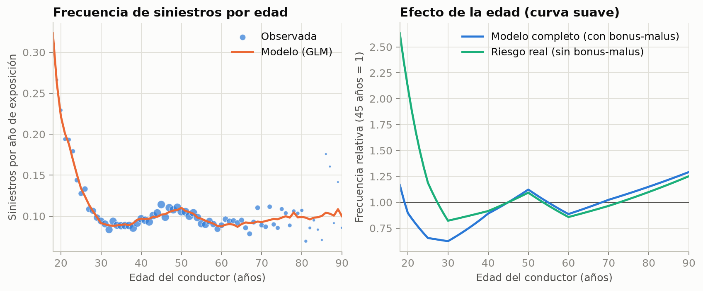
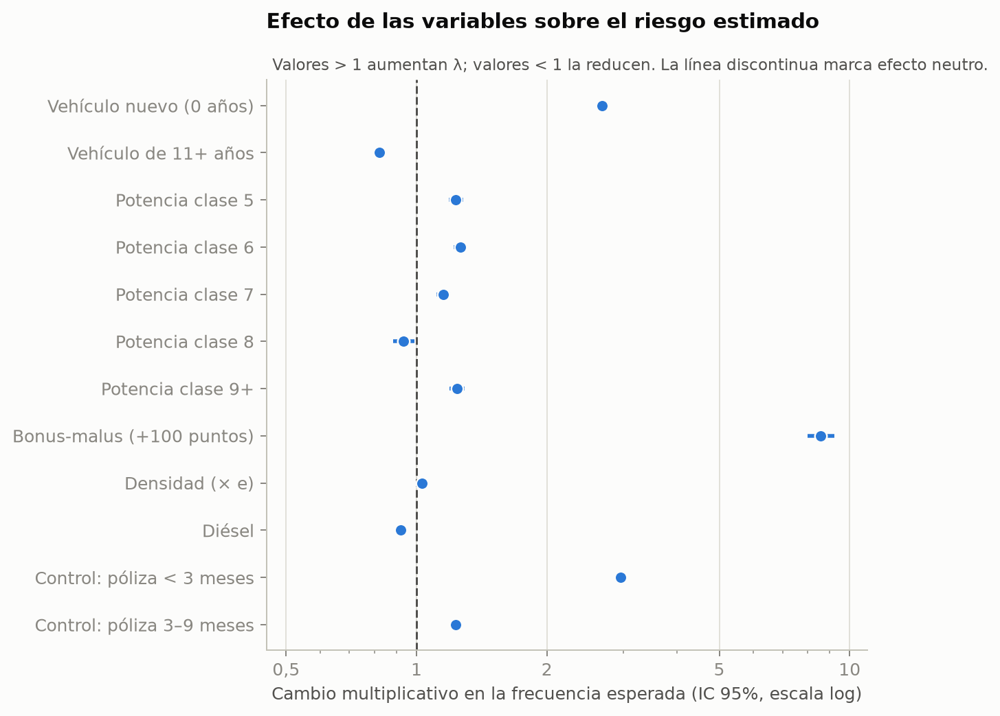
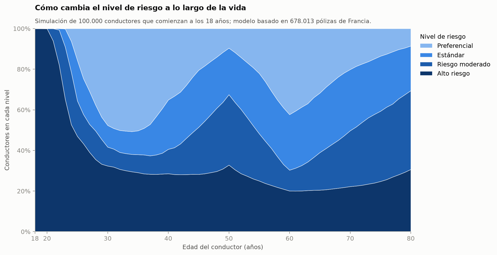
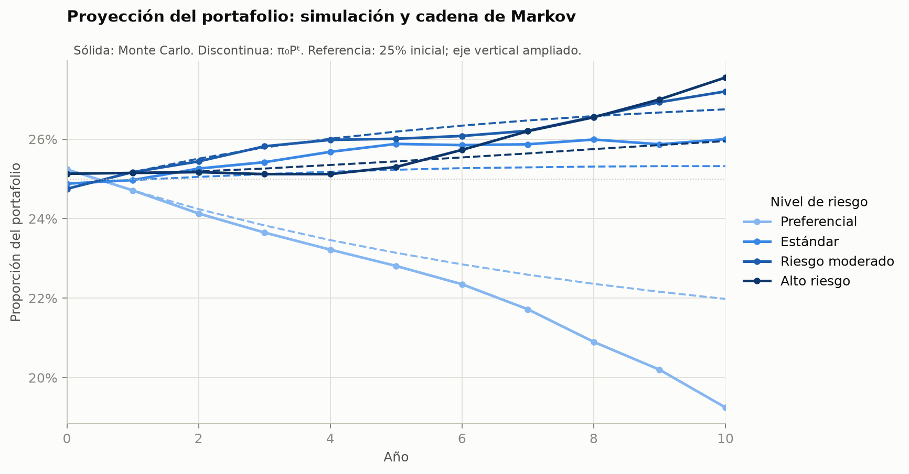
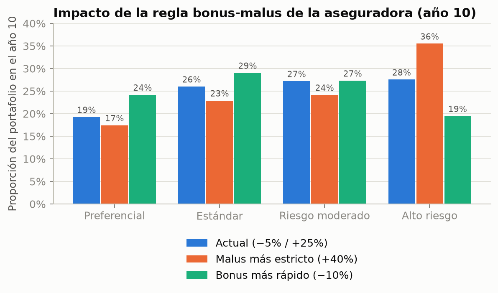
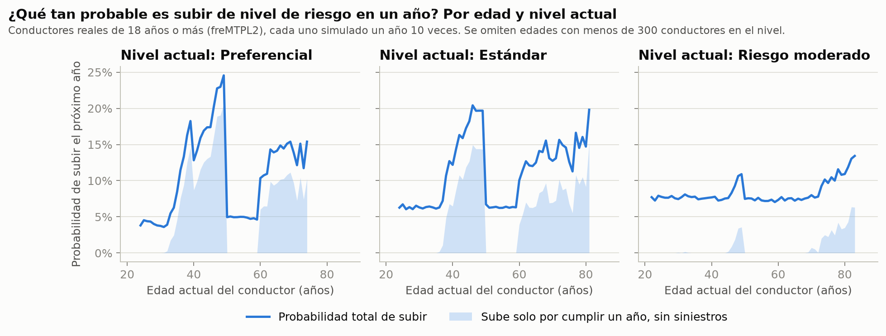

# Avance 2: mejoras al modelo y a la simulación

**Proyecto:** Modelado del riesgo de conductores asegurados y sus transiciones entre categorías
**Materia:** Modelado y Simulación
**Fecha:** 23 de octubre de 2026

Este avance atiende las limitaciones de la sección 6 del [Avance 1](AVANCE_1.md). El pipeline, los datos (678,013 pólizas reales de freMTPL2freq) y la estructura del código son los mismos; cambian el modelo, las simulaciones y las gráficas. Todos los números de este documento salen de `make run` con la semilla 2026.

## 1. Resumen de cambios

| # | Limitación del Avance 1 | Cambio |
|---|---|---|
| 1 | La edad en rangos producía saltos artificiales a los 31, 41, 51 y 71 años | La edad entra como un **spline lineal por tramos** (nodos en 20, 25, 30, 40, 50, 60 y 70 años). El riesgo cambia de forma continua con la edad |
| 2 | Efecto "vehículo nuevo" ×3.3, sospechoso | Se agregaron dos **variables de control por exposición** (póliza vigente menos de 3 meses, o de 3 a 9 meses). El efecto baja a ×2.7 |
| 3 | El portafolio a 10 años generaba siniestros con el bonus-malus actual (retroalimentación artificial) | El riesgo real de cada conductor queda **fijo en su valor inicial**; los siniestros solo cambian lo que ve la aseguradora |
| 4 | En el portafolio nadie envejecía | Los conductores **cumplen un año** en cada paso de la simulación |
| 5 | Todos los conductores con el mismo perfil tenían exactamente el mismo riesgo | Cada conductor simulado recibe una **heterogeneidad individual** (frailty Gamma) estimada de los datos |
| 6 | `assess_driver` solo daba el nivel actual | Ahora también **proyecta** el nivel del conductor a 1, 5 y 10 años |
| — | Gráficas del reporte en inglés | Todas las gráficas están en español |
| — | Filtro de edad implícito | El programa descarta explícitamente cualquier registro menor de 18 años, y la gráfica principal solo cuenta conductores de 18 años o más |

## 2. Cambios al modelo

### 2.1 Edad como curva suave

En lugar de 6 variables indicadoras por rango de edad, se usan 8 términos: el término *b* mide cuántas décadas de la vida del conductor caen entre el nodo *b* y el siguiente. Así, cada coeficiente es la **pendiente** de `log λ` por década en ese tramo, y la curva no tiene saltos. El modelo sigue siendo un GLM de Poisson y se ajusta igual (IRLS con Cholesky).



A la izquierda, la frecuencia observada por año de edad (el tamaño del punto es la exposición) contra el modelo. A la derecha, el efecto de la edad: el riesgo baja rápido de los 18 a los 30 años, sube hasta los 50, baja hasta los 60 y vuelve a subir. El pico de los 50 años está en los datos; una posible explicación es que a esa edad los hijos empiezan a manejar el auto asegurado a nombre de sus padres.

### 2.2 Control por exposición

En freMTPL2freq, las pólizas cortas tienen mucha más frecuencia de siniestros por año que las de un año completo:

| Exposición | Vehículo nuevo | Vehículo usado |
|---|---|---|
| < 3 meses | 0.891 | 0.207 |
| 3 a 9 meses | 0.221 | 0.104 |
| ≥ 9 meses | 0.125 | 0.074 |

Como las pólizas de vehículo nuevo son casi siempre cortas, el modelo del Avance 1 le atribuía al vehículo nuevo un efecto que en realidad venía de la duración de la póliza. Las dos variables de control absorben esa diferencia **solo durante el ajuste**: λ siempre se calcula para un año completo, así que los controles no cambian el riesgo de nadie. El efecto del vehículo nuevo bajó de ×3.3 a ×2.7. Sigue siendo alto (en pólizas de un año completo es ≈ ×1.7), así que conviene seguir revisándolo.



### 2.3 Ajuste

| Métrica (conjunto de prueba, 67,779 pólizas) | Avance 1 | Avance 2 |
|---|---|---|
| Devianza Poisson, modelo nulo | 0.3301 | 0.3301 |
| Devianza Poisson, GLM | 0.3134 | 0.3061 |
| Reducción | 5.1% | **7.3%** |

Parte de la mejora viene de los controles de exposición, que explican diferencias de frecuencia entre pólizas largas y cortas pero no dicen nada del conductor.

### 2.4 Heterogeneidad entre conductores

El GLM da el riesgo *promedio* de un perfil, pero dos conductores con la misma edad, auto y zona no manejan igual. Esa variación se mide con la **dispersión** φ, estimada por momentos:

$$\text{Var}(N) = \mu + \varphi\,\mu^2, \qquad \hat\varphi = \frac{\sum (y_i - \mu_i)^2 - y_i}{\sum \mu_i^2}$$

| Modelo | φ |
|---|---|
| Riesgo real (sin bonus-malus) | 0.77 |
| Completo (con bonus-malus) | 0.60 |

La dispersión baja cuando se incluye el bonus-malus porque el historial ya explica parte de las diferencias entre conductores. En la simulación, cada conductor recibe un multiplicador de su riesgo θ ~ Gamma con media 1 y varianza φ (generador de Marsaglia y Tsang, en `src/rng.c`). Esto equivale a un modelo binomial negativo, que es el estándar actuarial cuando hay sobredispersión.

## 3. Resultados

### 3.1 Los 4 niveles

Los umbrales siguen siendo los cuartiles de λ:

| Nivel | Rango de λ | λ medio | P(≥1 siniestro), Monte Carlo | Exacta |
|---|---|---|---|---|
| Preferencial | < 0.0602 | 0.052 | 0.049 ± 0.003 | 0.052 |
| Estándar | 0.0602 – 0.0723 | 0.066 | 0.063 ± 0.003 | 0.064 |
| Riesgo moderado | 0.0723 – 0.0925 | 0.080 | 0.073 ± 0.004 | 0.076 |
| Alto riesgo | > 0.0925 | 0.161 | 0.135 ± 0.005 | 0.134 |

Los umbrales son más bajos que en el Avance 1 porque λ ahora se calcula siempre para un año completo, sin el efecto inflado de las pólizas cortas.

### 3.2 Nivel de riesgo por edad, desde los 18 años

Solo se cuentan conductores de 18 años o más. Los 100,000 conductores simulados parten de los 6,816 perfiles reales de 18 a 20 años.



| Edad | Preferencial | Estándar | Moderado | Alto riesgo |
|---|---|---|---|---|
| 18 | 0% | 0% | 0% | **100%** |
| 25 | 16% | 20% | 17% | 47% |
| 30 | **48%** | 11% | 9% | 32% |
| 40 | 35% | 24% | 12% | 29% |
| 50 | 10% | 23% | 35% | 33% |
| 60 | 42% | 27% | 10% | **20%** |
| 70 | 20% | 30% | 27% | 22% |
| 80 | 9% | 22% | 39% | 31% |

Diferencias con el Avance 1:

- **Ya no hay saltos** a los 31, 41, 51 y 71 años; la curva sigue la forma de la frecuencia observada.
- Los conductores salen de Alto riesgo **más rápido**: a los 30 años, 48% es Preferencial (antes 23%). Con la heterogeneidad, los conductores cuidadosos acumulan años sin siniestros y bajan de nivel; los descuidados se quedan arriba. Por eso cerca de 20%–30% permanece en Alto riesgo a cualquier edad.

### 3.3 Portafolio a 10 años y cadena de Markov

Matriz de transición estimada con el primer año simulado:

| De \ A | Preferencial | Estándar | Moderado | Alto |
|---|---|---|---|---|
| **Preferencial** | 0.900 | 0.074 | 0.025 | 0.002 |
| **Estándar** | 0.080 | 0.812 | 0.088 | 0.019 |
| **Moderado** | 0.000 | 0.117 | 0.803 | 0.079 |
| **Alto** | 0.000 | 0.000 | 0.098 | 0.902 |

Distribución estacionaria: **π∞ = (0.20, 0.25, 0.27, 0.27)**.



Ahora la proporción de Preferenciales **baja** con el tiempo (de 25% a 19% en 10 años), cuando en el Avance 1 subía. Hay dos razones. Primero, los conductores envejecen, y muchos pasan por el aumento de riesgo de los 30 a los 50 años. Segundo, muchos conductores empiezan con el bonus-malus mínimo (50), así que solo pueden subir.

La cadena de Markov y la simulación difieren en **2.7 puntos** en el año 10 (antes 2.6). La diferencia sigue mostrando que la propiedad de Markov es solo una aproximación: el nivel no resume la edad ni el riesgo individual del conductor.

### 3.4 Escenarios de política

| Nivel (año 10) | Actual (−5% / +25%) | Malus más estricto (+40%) | Bonus más rápido (−10%) |
|---|---|---|---|
| Preferencial | 19.3% | 17.4% | 24.2% |
| Estándar | 26.0% | 22.9% | 29.0% |
| Moderado | 27.2% | 24.2% | 27.3% |
| Alto | 27.6% | **35.5%** | 19.5% |



La conclusión del Avance 1 se mantiene: un malus más estricto aumenta el nivel de Alto riesgo en unos 8 puntos en 10 años.

### 3.5 Evaluación individual con proyección

```bash
./assess_driver --age 30 --veh-age 5 --bonus-malus 70 --seed 1
```
```
Expected claims per year (lambda):  0.0798
P(at least one claim), Monte Carlo: 0.0745 +/- 0.0051 (10000 simulated years)
Exact P(at least one claim):        0.0767
Risk level:                         Moderate Risk

Projection (10000 simulated futures, French bonus-malus rule)
 year  age   Preferential       Standard  Moderate Risk      High Risk
    1   31           0.0%           0.0%          92.7%           7.3%
    5   35           0.0%          68.9%           0.0%          31.1%
   10   40           0.0%           0.0%          73.3%          26.7%
```

Como el auto y la zona son fijos, el nivel solo depende de la edad y del bonus-malus. Sin siniestros, el bonus-malus baja siempre por el mismo camino, así que la distribución se concentra en pocos niveles. A los 40 años, aunque el bonus-malus llegue al mínimo, el aumento del riesgo con la edad lo deja en Riesgo moderado.

### 3.6 Probabilidad de subir de nivel, por edad y nivel actual

¿Qué tan probable es que un conductor suba al menos un nivel el próximo año, según su edad y su nivel actual? Para cubrir todas las edades se usaron los 678,013 conductores reales (todos de 18 años o más). Cada uno se simuló un año 10 veces, con las mismas reglas del portafolio. "Alto riesgo" no aparece porque no puede subir más.



La línea es la probabilidad total de subir. El área sombreada es la parte que ocurre **aunque el conductor no tenga ningún siniestro**: solo por cumplir un año, el modelo le asigna más riesgo.

| Edad | Preferencial | Estándar | Moderado |
|---|---|---|---|
| 25 | 4.5% (0.0%) | 6.7% (0.0%) | 7.8% (0.0%) |
| 35 | 8.5% (4.6%) | 6.1% (0.0%) | 7.8% (0.0%) |
| 45 | **17.4% (13.3%)** | **18.2% (12.7%)** | 7.6% (0.2%) |
| 55 | 5.0% (0.0%) | 6.2% (0.0%) | 7.3% (0.0%) |
| 70 | 13.9% (9.7%) | 12.7% (7.0%) | 8.0% (0.7%) |

*Entre paréntesis: la parte que ocurre sin siniestros.*

- **Sin el efecto de la edad**, la probabilidad de subir es de 5% a 8%: es la probabilidad de tener un siniestro en el año.
- **De los 35 a los 50 y después de los 60**, el riesgo del modelo aumenta con la edad. Un conductor que está cerca del límite de su nivel lo cruza aunque no tenga siniestros, y la probabilidad de subir llega a ≈ 20%–25%.
- **De los 50 a los 60** el riesgo baja con la edad. El descuento del bonus-malus y la edad empujan en la misma dirección, así que solo sube quien tiene un siniestro.
- En "Riesgo moderado" la edad casi no influye: subir a Alto riesgo requiere casi siempre un siniestro.

Las edades con menos de 300 conductores reales en un nivel se omiten porque la estimación sería muy ruidosa; por eso las curvas no empiezan en 18. Hay muy pocos conductores jóvenes en los niveles bajos.

## 4. Pruebas

`make test` corre 12 pruebas (antes 7). Las nuevas verifican:

1. Media y varianza del generador Gamma de la heterogeneidad.
2. Continuidad del spline de edad: sin saltos entre tramos.
3. Que λ siempre sea para un año completo, sin importar la exposición.
4. Que la carga de datos descarte registros de menores de 18 años.
5. Que en la simulación de vida las proporciones de cada edad sumen 1.

## 5. Limitaciones que siguen abiertas

1. **Vehículo nuevo (×2.7).** El control de exposición redujo el efecto, pero no lo eliminó.
2. **Heterogeneidad a priori en el portafolio.** La heterogeneidad de cada conductor del portafolio se toma de la distribución general, sin condicionar a su historial real. Lo correcto sería una distribución a posteriori, que requiere conocer el número de siniestros pasados de cada póliza.
3. **Niveles relativos.** Los niveles siguen siendo cuartiles.
4. **Solo frecuencia.** Falta la severidad (freMTPL2sev) para obtener el costo esperado.
5. **Datos de Francia.**
